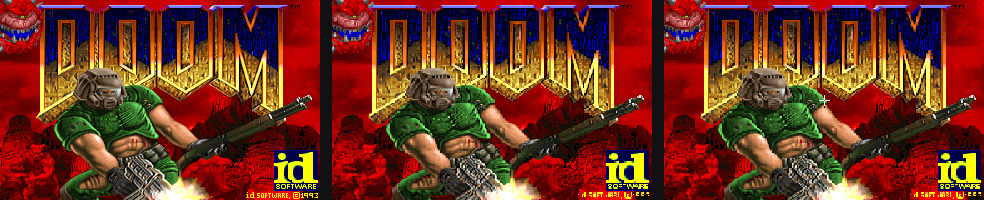
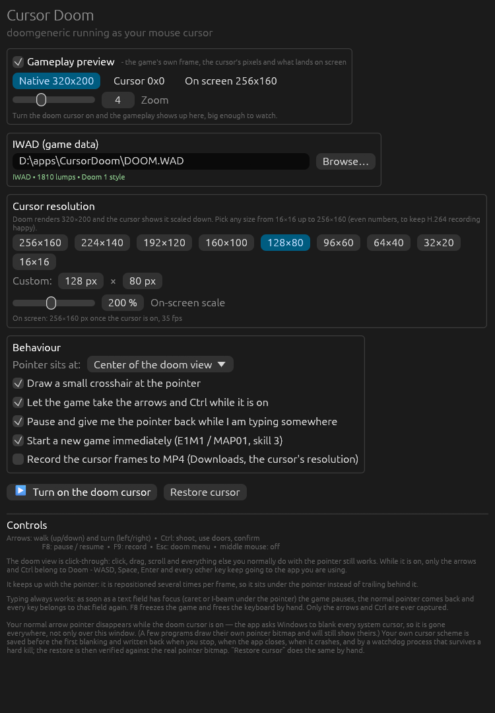
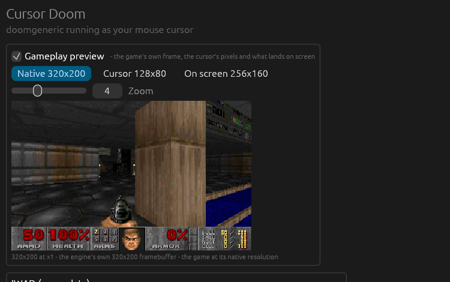
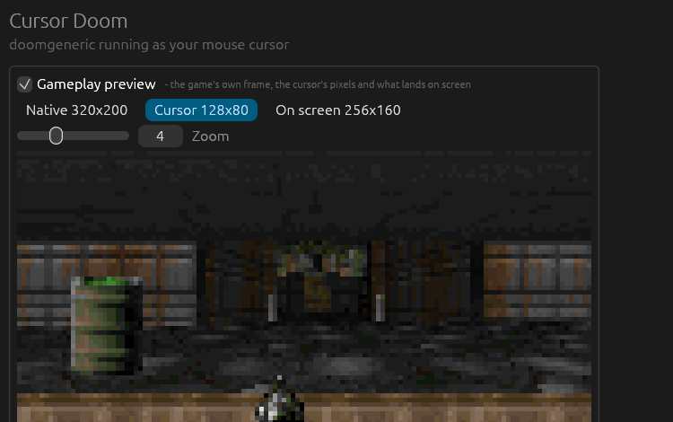
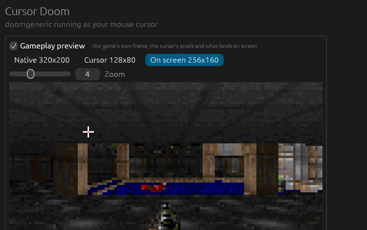
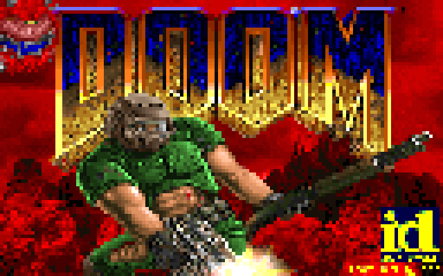
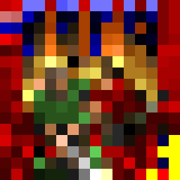

# Cursor Doom

[](https://github.com/virusdeflect21/cursor-doom/actions/workflows/ci.yml)
[](LICENSE)
[](#requirements)

**Doom, as your mouse cursor.**

Cursor Doom runs the [doomgeneric](https://github.com/ozkl/doomgeneric) engine in a tiny
always-on-top window glued to your pointer, so the pointer *is* the game. The normal arrow
cursor disappears while it is on, every click / drag / scroll still reaches whatever is
underneath, and the middle mouse button turns it off again.



<p align="center"><em>One frame at three stages: engine 320×200 → cursor 256×160 → on screen 512×320.</em></p>

## What it looks like

The launcher - WAD picker, cursor resolution, on-screen scale, behaviour switches and a live
preview of the game itself:



The preview can show three views of the same live frame - the engine's own 320×200 output,
the pixels the cursor is actually made of, and what lands on the desktop (scale + reticle):

| Native 320×200 | Cursor 128×80 (the pixels the pointer is made of) | On screen 256×160 |
| --- | --- | --- |
|  |  |  |

The cursor itself, at two of the supported sizes, magnified with nearest-neighbour so the
pixels stay square (these are frames the app rendered):

| 128×80, ×5 | 16×16, ×16 |
| --- | --- |
|  |  |

A 16×16 cursor recorded to MP4 and decoded back out of the file (the encoder needs 34×34, so
it is stored at 48×48, ×3):


## Features

- **Real Doom, real cursor.** doomgeneric renders 320x200; the frame is downscaled to
  anything from **16x16 to 256x160** and painted as the pointer image at 25-400%.
- **It behaves like a cursor.** Click-through, never takes focus, and follows the pointer
  within a millisecond (the overlay is repositioned during the engine's own frame wait, not
  once per frame).
- **Only the arrows and Ctrl are taken from the desktop.** Everything else, including WASD,
  Space and Enter, keeps working in the application you are using.
- **Typing always wins.** As soon as a text field has focus (caret or I-beam) the game
  pauses, the real pointer comes back and the keyboard is released. Leave the field and the
  game resumes exactly where it froze.
- **Launcher with a live preview** of the three things that matter: the engine's native
  320x200 framebuffer, the pixels the cursor is made of, and the image that actually lands
  on screen (display scale + reticle), each zoomable 1x-10x.
- **MP4 recording from 16x16 up**, 35 fps H.264, only the cursor frames, straight into
  `Downloads`. Sizes the encoder refuses are upscaled by a whole number (16x16 -> 48x48), so
  pixel art stays pixel art.
- **Cannot strand you without a pointer.** Cursors are restored on stop, on crash, and by a
  separate `cursor-guard.exe` watchdog that survives `taskkill /F` of the app.

## Requirements

- Windows 10/11 (x64)
- Rust 1.82+ with the MSVC toolchain (Visual Studio 2022 build tools)
- A Doom IWAD you own (`DOOM.WAD`, `DOOM1.WAD`, `DOOM2.WAD`, `TNT.WAD`, `PLUTONIA.WAD`)

The engine's C sources are vendored in `doomgeneric/` and compiled into the binary by
`build.rs` - no DLLs, no ffmpeg, no SDKs. Point `DOOMGENERIC_DIR` at another engine checkout
to build against it instead.

**This repository ships no game data.** Doom is still sold by id/Bethesda, and GOG sells it
too; any of those IWADs works. Put the WAD in the repository root or pick it in the launcher.

## Download

Every tagged release carries a ready-to-run `cursor-doom-vX.Y.Z-windows-x64.zip` on the
[releases page](https://github.com/virusdeflect21/cursor-doom/releases) (built by CI, with a
SHA-256 next to it). Extract it, drop your IWAD beside the exe, and run it - no toolchain
needed. The build is unsigned, so SmartScreen may ask once.

## Build and run

```sh
git clone https://github.com/virusdeflect21/cursor-doom
cd cursor-doom/cursor-doom
cargo build --release
./target/release/cursor-doom.exe
```

The launcher opens. Choose the WAD, the cursor resolution (default 256x160), the on-screen
scale and the anchor, then press **Turn on the doom cursor**.

## Controls

| Input | Action | Captured? |
| --- | --- | --- |
| `Up` / `Down` | walk forward / back | yes |
| `Left` / `Right` | turn left / right | yes |
| `Ctrl` (left or right) | shoot, use doors and switches, confirm menu entries | yes |
| `Esc` | Doom's menu | no (also reaches the app) |
| `F8` | freeze / resume the game, keyboard released | yes |
| `F9` | start / stop MP4 recording | yes |
| **Middle mouse** | **turn the doom cursor off** | yes |
| everything else | your applications, untouched | no |

Doom has no vertical look, so the arrows are Doom's own defaults: left/right turn, up/down
walk. Ctrl is a single action key: it fires, opens doors and picks the highlighted menu
entry. WASD, Space and Enter are deliberately *not* mapped, so typing and shortcuts in other
applications keep working.

Vanilla Doom cannot be paused while playing, so `F8` pauses by freezing the *engine clock*:
the simulation stops, the frame stays on the cursor, and resuming continues from exactly the
same tic. `Esc` opens Doom's menu, which pauses a single-player game the way it always did.

## Typing and pausing

- A text field with a **caret** or the **I-beam** cursor under the pointer pauses the game:
  overlay hidden, normal pointer back, keyboard released.
- Any typed character also pauses for a moment, even in applications that draw their own
  cursor and have no Win32 caret.
- Leaving the text field resumes the game with no catch-up burst (the engine clock is frozen,
  not skipped).
- `F8` does the same by hand at any time.
- Launcher switches: *Let the game take the arrows and Ctrl* and *Pause and give me the
  pointer back while I am typing somewhere*.

## Recording

Tick **Record the cursor frames to MP4**. Only the cursor image is recorded - no desktop, no
other windows - at 35 fps, H.264, saved as
`%USERPROFILE%\Downloads\cursor-doom-YYYYMMDD-HHMMSS.mp4`.

| Cursor size | Video file |
| --- | --- |
| 16x16 | 48x48 (x3) |
| 32x20 | 64x40 (x2) |
| 64x40 and up | unchanged |

Windows' H.264 encoder refuses frames below 34x34, so small cursors are upscaled by a whole
number with nearest-neighbour sampling: the video shows exactly the cursor pixels, just
bigger. The launcher and the session status (`record_size`, `record_scale`, `record_note`)
tell you what will be written. `F9` toggles recording while the cursor is running.

## Live preview

The launcher can show what the cursor is drawing, magnified, in three views:

1. **Native** - the engine's own 320x200 framebuffer.
2. **Cursor** - the pixels the cursor is actually made of (your chosen resolution).
3. **On screen** - the image that lands on the desktop: display scale and reticle included,
   built with the same code the session uses.

Frames travel through `%APPDATA%\CursorDoom\preview.bin` (a small header plus two BGRA
planes, written to a temporary file and renamed into place, so the launcher never reads half
a frame). The preview is sampled 10 times a second and never touches the frame rate.

## Cursor safety

While a session runs, Cursor Doom replaces **all 14 Windows system cursors** with a
transparent one (`SetSystemCursor`), so the arrow is gone everywhere, not only over the game.

That API has a trap worth knowing: it overwrites the *stored* cursor scheme in
`HKCU\Control Panel\Cursors`, so a plain `SystemParametersInfo(SPI_SETCURSORS)` reloads the
blank cursors and the pointer stays invisible. Cursor Doom therefore:

1. saves your scheme before the first blanking, to
   `%APPDATA%\CursorDoom\cursor-scheme.txt`;
2. writes it back and reloads it when you stop, when the launcher closes, when the session
   crashes (unhandled-exception filter) and from the watchdog;
3. verifies the result against the real pointer bitmap and, if the pointer is still blank,
   puts the stock Windows cursors back role by role until it is visible again.

The watchdog is `%APPDATA%\CursorDoom\cursor-guard.exe`, a *copy* of the binary under its own
name: it waits on the session process and restores the cursors when it disappears -
including when it is killed with `taskkill /F` (measured: pointer back within 0.25 s).

If a pointer ever does go missing: `cursor-doom.exe --restore-cursor`, or the **Restore
cursor** button in the launcher. `--cursor-dump out.bmp` shows what Windows is currently
drawing for the pointer, as a BMP plus an ASCII picture in the terminal.

## Command line

```
cursor-doom                            open the launcher
cursor-doom --session --wad <wad> [--width 256] [--height 160] [--scale 100]
           [--anchor center|topleft] [--reticle 0|1] [--record 0|1]
           [--autostart 0|1] [--no-hide-cursor] [--no-capture]
           [--no-typing-pause] [--no-overlay] [--no-hooks]
           [--status-file <path>] [--stop-event <name>] [--parent-pid <pid>]
           [--max-frames <n>]
cursor-doom --selftest --wad <wad> [--frames 90] [--out <dir>] [--record]
           [--real-time] [--width 256] [--height 160] [--scale 100]
cursor-doom --probe <file.mp4> --out <dir>
cursor-doom --screenshot <file.bmp>
cursor-doom --cursor-report
cursor-doom --cursor-dump <file.bmp>
cursor-doom --restore-cursor
```

- `--selftest` runs the engine headless, writes `engine-*.bmp`, `display-*.bmp`,
  `cursor-*.bmp` (and an MP4 with `--record`) and prints a summary - the way the renderer is
  checked without touching the desktop.
- `--probe` decodes the first frame of an MP4 so recordings can be verified.
- `--screenshot` renders the launcher once, saves the window to a BMP and exits (this is how
  the screenshots above were taken).
- `--cursor-report` prints the live cursor handle, size, monochrome flag and whether it is the
  transparent placeholder.
- `--cursor-dump <file.bmp>` decodes the pointer bitmap into a BMP and prints an ASCII
  coverage map - the fastest way to see whether the pointer is really there.
- `--no-capture` makes the cursor display-only, `--no-typing-pause` disables the automatic
  typing pause, `--no-overlay` / `--no-hooks` / `--no-hide-cursor` are diagnostics.

State lives in `%APPDATA%\CursorDoom`: `session.status` (live key=value snapshot),
`session.log`, `crash.log` (stack trace if the engine ever faults), `settings.txt` (launcher
settings), `preview.bin` (the live preview), `cursor-scheme.txt` (your cursors, saved before
they are blanked) and `cursor-guard.exe`.

## How it works

```
DOOM.WAD -> doomgeneric (C, vendored, compiled by build.rs at 320x200)
         -> engine.rs     FFI: DG_* callbacks, pause-able clock
         -> frame.rs      nearest-neighbour downscale + optional reticle
         -> overlay.rs    layered, click-through, topmost, no-activate window
         -> hooks.rs      WH_KEYBOARD_LL / WH_MOUSE_LL on their own thread
         -> record.rs     Media Foundation H.264 SinkWriter
         -> preview.rs    the launcher's three views
         -> scheme.rs     saves/restores your Windows cursor scheme
```

- `build.rs` compiles 83 engine sources with `DOOMGENERIC_RESX=320`, `RESY=200`.
- `engine.rs` owns the argument vector the engine keeps pointers into (a local `Vec` would
  dangle and crash inside `M_CheckParm`), plus the pause-able clock.
- `hooks.rs` installs the hooks on a dedicated thread with its own pump: Windows blocks all
  input while the thread that installed a low-level hook is busy, which used to freeze the
  desktop whenever the engine loaded a level. They are re-armed every few seconds because
  Windows silently drops low-level hooks.
- `session.rs` runs the loop at 35 fps on absolute deadlines, drains events between tics, and
  keeps the overlay glued to the pointer from the engine's idle callback.
- `launcher.rs` spawns the same executable with `--session`, polls `session.status` for the
  live panel and restores the cursors when the child exits - a crash in the C engine can
  never leave you without a pointer.

## Development

```sh
cargo test --release        # key bindings, cursor scheme backup, launcher -> worker handshake
cargo clippy --release --all-targets -- -D warnings
cargo fmt --all
tools/verify-cursor.ps1     # live overlay: styles, size, tracking latency, cursor state
tools/smoke-overlay.ps1     # starts a session, moves the pointer, screenshots
```

Pointer diagnostics used while building this (no GUI needed):

```sh
cursor-doom.exe --cursor-dump before.bmp   # must show the arrow
cursor-doom.exe --session --wad DOOM.WAD    # the arrow must vanish
cursor-doom.exe --cursor-dump during.bmp   # must be empty (0.0% coverage)
cursor-doom.exe --restore-cursor           # must report the pointer as visible
cursor-doom.exe --cursor-dump after.bmp    # the arrow again
```

## Legal

Doom is a trademark of id Software. This project contains no Doom assets and no game data:
you must supply your own IWAD.

The launcher, overlay and glue in this repository are MIT licensed - see [LICENSE](LICENSE).
`doomgeneric/` is a vendored, unmodified copy of [doomgeneric](https://github.com/ozkl/doomgeneric)
licensed under **GPL-2.0** (see `doomgeneric/LICENSE`); the release binary links it, so binary
builds are GPL-2.0 as a whole.
